# lending-updates

The LLAMMA concept on LlamaLend v2: the charts below, the four changed contracts in `vyper/`, and the research code that makes the charts in `scripts/`.

## What changes

Compared with LlamaLend v2 as deployed, in two variants: DL off (a one-way AMM) and DL on (v2's two-way AMM with a 4x fee).

**For borrowers**

- **Liquidation stops at a target health.** A liquidator repays only enough to bring the loan back to +100 % health. The borrower keeps the rest of the position.
- **A smaller liquidation bonus.** The bonus slides from 0.5 % for a loan just below zero health to 1.5 % at -5 % and below, so a loan that is barely underwater pays little.
- **No buy-back at a loss (DL off).** Collateral the AMM sells as the price falls is never bought back on a rebound, so converted crvUSD stays crvUSD.
- **Borrowing is never blocked.** A new loan can use bands that hold another loan's converted crvUSD, with each holder's share tracked as credit, so the one-way AMM refuses no borrowing.
- **Partly converted loans stay usable.** Adding collateral, borrowing and removing collateral first repay debt from the loan's own converted crvUSD instead of reverting.

**For safety**

- **A manipulation-resistant oracle.** The WindowOracle reads only its own pool's EMA, follows the highs and lows of the last 36 seconds and moves at most 0.2 % per 12 seconds. Nothing a caller does inside one block can move it.
- **No sales ahead of the oracle.** Collateral is sold only from bands the oracle price has reached, which stops dust trades and sales into a rally.
- **Health that cannot be gamed.** Converted coins count at face value and a loan holding them gets no above-band bonus, so no loan opened above it can make it unliquidatable.
- **Checked storage and deployment.** Packed counters are checked before they are written, and the oracle rejects a wrong pool, coin index, stablecoin or a zero price at deployment.
- **Nothing existing changes.** All 17 deployed v2 contracts keep identical ABIs, existing markets are untouched, and new markets launch through new factories with small caps.

**Results**, 18 markets, 1 Jan 2025 to 4 Jul 2026, replayed with every real borrower action:

- **Borrower losses:** $10.18M today, $1.47M with DL off (-86 %), $2.74M with DL on (-73 %).
- **Bad debt:** $0.72M today, $0.20M with DL off (-72 %), $0.73M with DL on.

### Losses

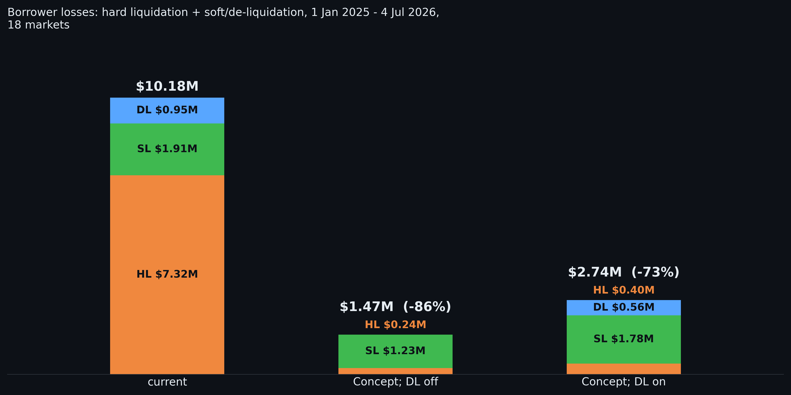

### Bad debt

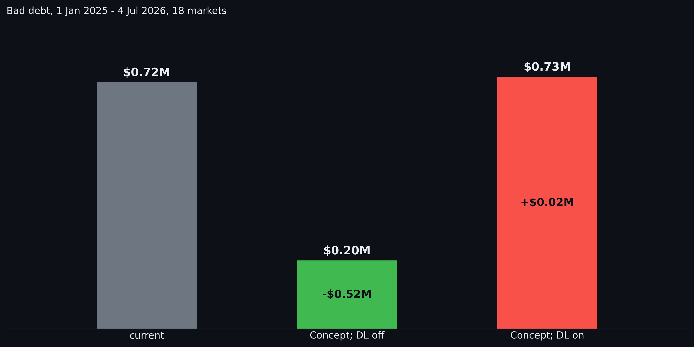

### Losses, with the Aave v3 and Aave v4 equivalents

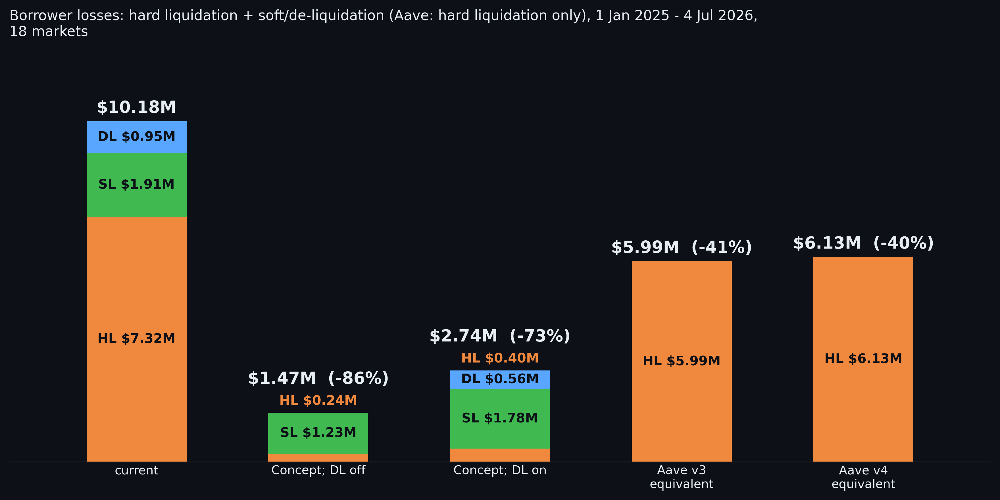

## By the pool the oracle reads

### tricrypto-ng: losses, 13 markets (wstETH, WETH, tBTC, CRV, WBTC, WETH, wstETH, tBTC, tBTC, sfrxETH, WETH, WBTC, wstETH)

### tricrypto-ng: bad debt

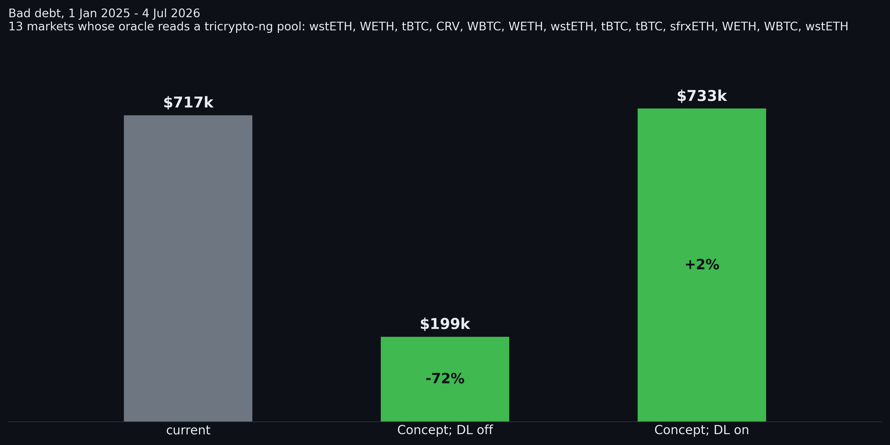

### twocrypto-ng: losses, 1 market (ynETH)

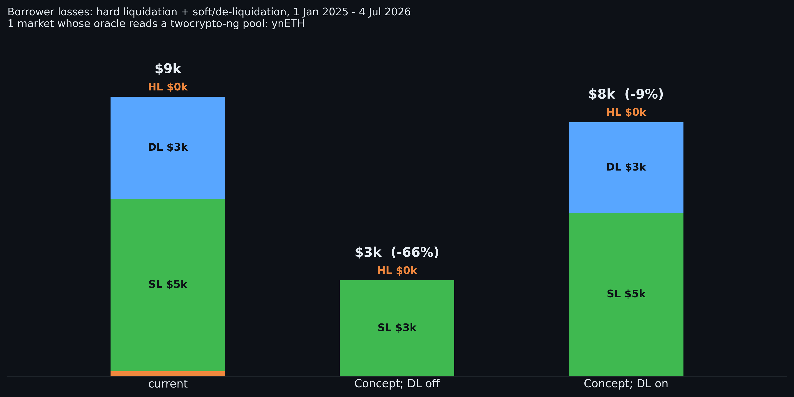

### stableswap-ng: losses, 3 markets (ynETHx, LBTC, cbBTC)

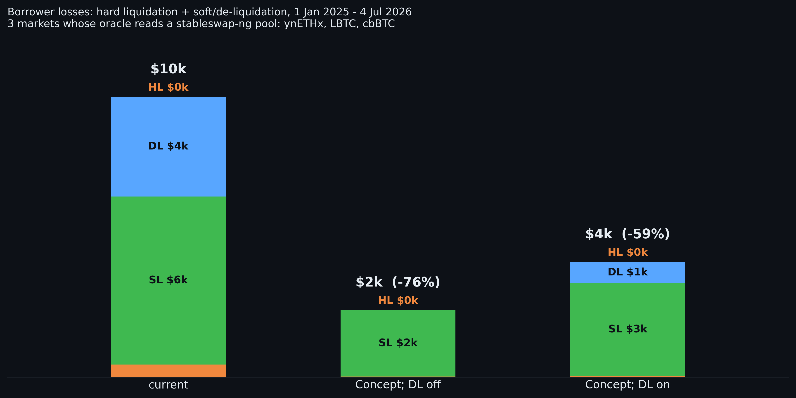

### Oracle drift comparison

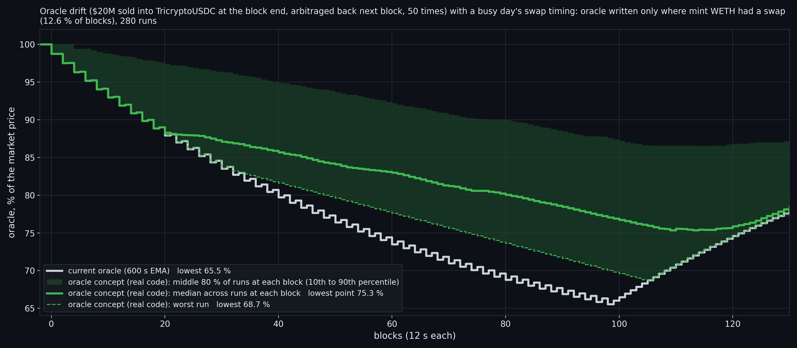

### Oracle response to a $20M sell into the pool

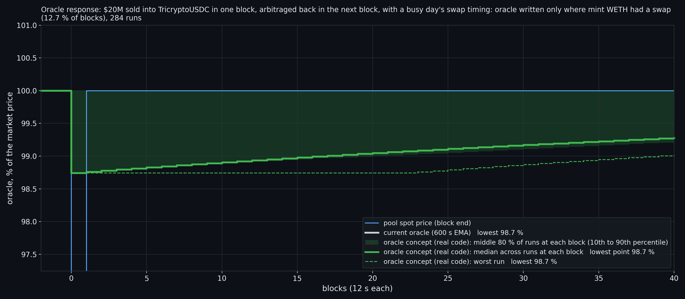

### Oracle response to a $20M sell held down for 10 blocks

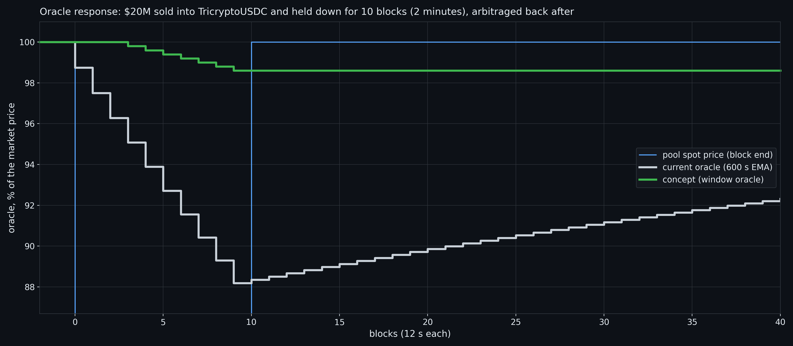

### Oracle staleness: the attacker pumps every block end during a crash

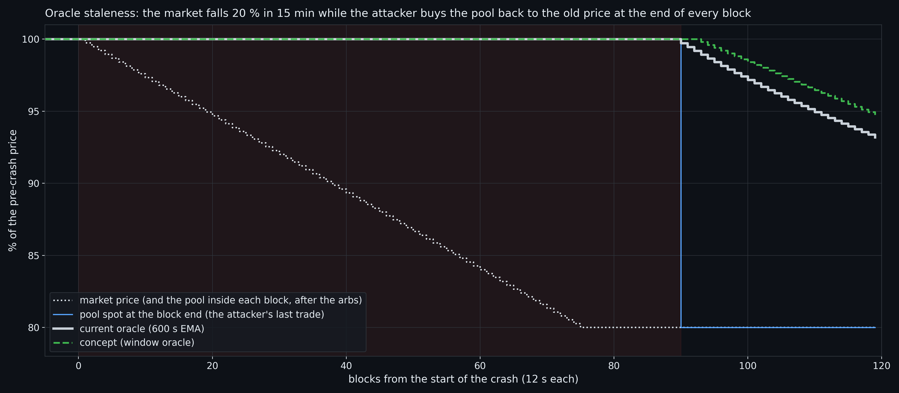

### Two weeks of September 2026: ETH spot vs the two oracles

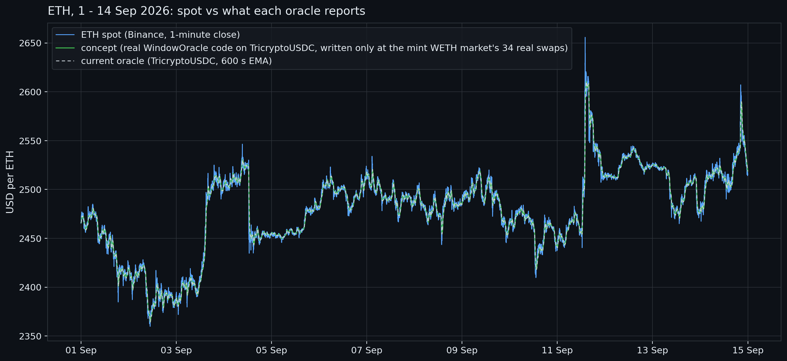

### WindowOracle.vy: transaction cost

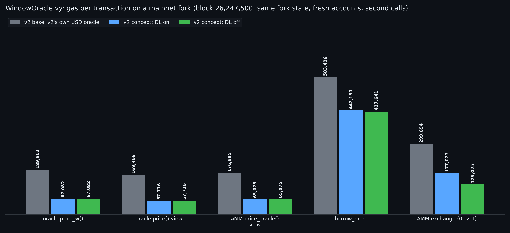

### WindowOracle.vy: bytecode size

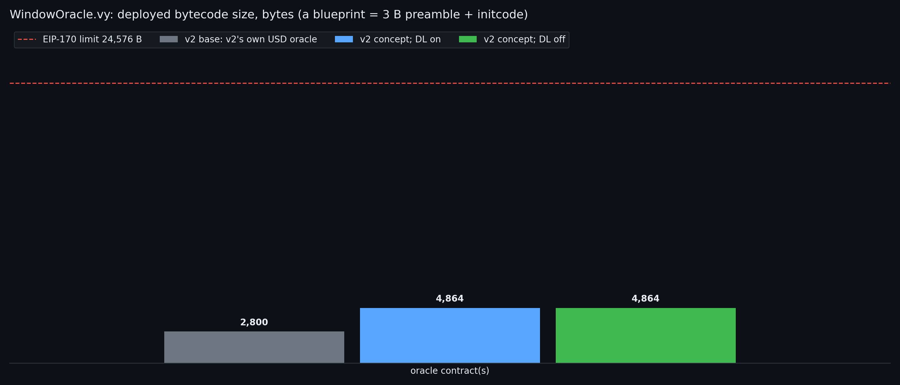

### controller.vy: transaction cost: borrower calls

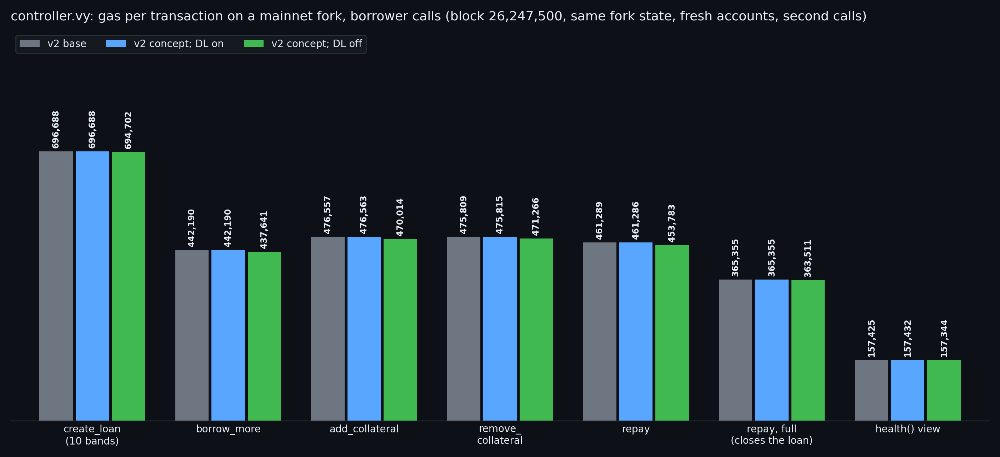

### controller.vy: transaction cost: liquidation

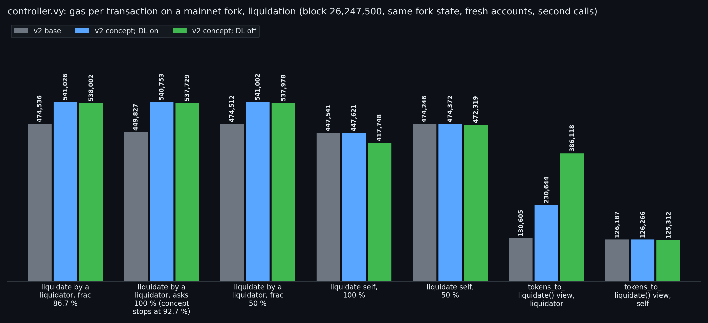

### controller.vy: bytecode size

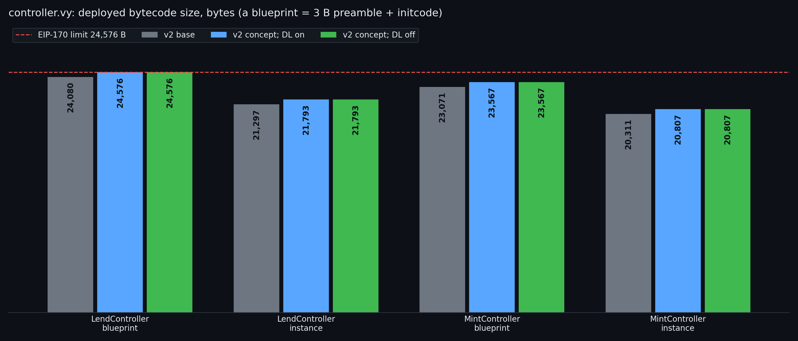

### ControllerView.vy: transaction cost

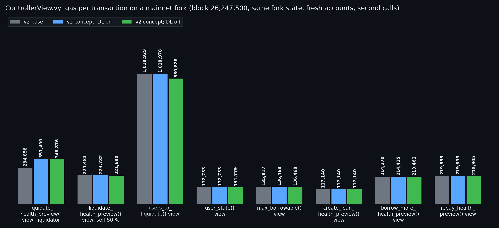

### ControllerView.vy: bytecode size

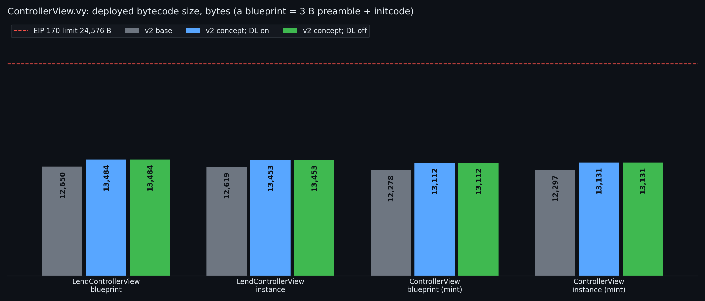

### AMM.vy: transaction cost

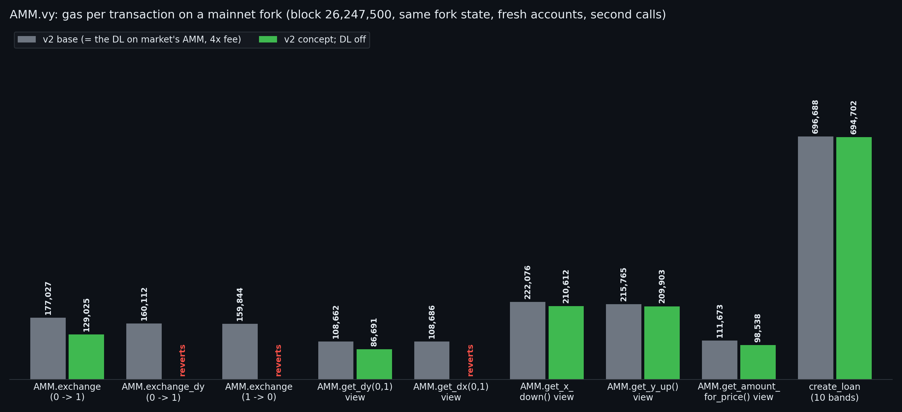

### AMM.vy: bytecode size

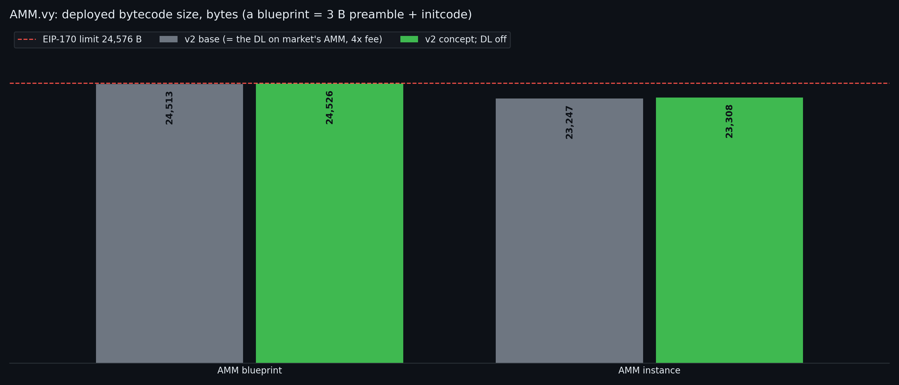

## scripts

- `make_charts.py`: losses, bad debt, the Aave equivalents, the by-pool charts, gas and size, and the two oracle model charts, from the engine runs and the fork measurement.
- `oracle_charts/`: the oracle drift, the $20M sell and September 2026 charts, on the compiled `WindowOracle.vy`.
- `engine/`: the market replay behind the losses and bad debt, its run script, the CRV market's re-run on TriCRV's real sale quotes, the concept's re-run with health +100 % after a liquidation, and the Aave equivalents' re-run on Aave's own rules and parameters.
- `r3/` and `oracles.py`: the oracle and pool models the charts use.
